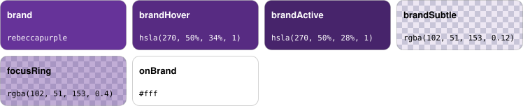
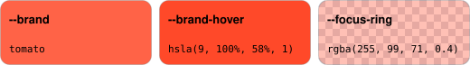
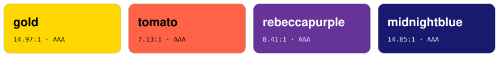
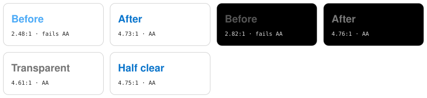
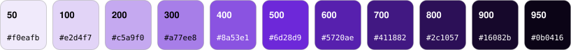
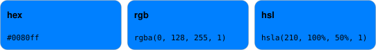

<p align="center">
  <a href="https://color2k.com">
    
  </a>
</p>

<p align="center">
  <strong>Color parsing and manipulation in 2.4 kB.</strong><br />
  Zero dependencies. Tree-shakeable. TypeScript included.
</p>

<p align="center">
  <a href="https://www.npmjs.com/package/color2k"></a>
  <a href="https://bundlephobia.com/package/color2k"></a>
  <a href="https://github.com/ricokahler/color2k/actions/workflows/test.yml"></a>
  <a href="https://codecov.io/gh/ricokahler/color2k"></a>
  <a href="https://www.npmjs.com/package/color2k"></a>
</p>

<p align="center">
  <a href="#quickstart">Quickstart</a> ·
  <a href="#recipes">Recipes</a> ·
  <a href="#api">API</a> ·
  <a href="https://color2k.com">color2k.com</a> ·
  <a href="https://color2k.com/llms.txt">llms.txt</a>
</p>

## Why color2k

Most apps need a handful of color jobs: darken a brand color for a hover state, fade it for a focus ring, pick black or white text, check contrast. color2k does those jobs and nothing else, so it costs almost nothing to ship.

- **Tiny.** 2.4 kB for everything, about 1.6 kB if you only import `darken`.
- **Plain functions.** CSS color strings go in, CSS color strings come out. No classes, no chaining, no plugins.
- **Everything you reach for.** Parse, convert, lighten, darken, saturate, fade, mix, build scales and check WCAG contrast.
- **Safe to depend on.** Zero dependencies, a thorough test suite, TypeScript types and npm provenance.

| Library | Size (min + gzip) |
| --- | --- |
| [chroma-js](https://github.com/gka/chroma.js) | [16.7 kB](https://bundlephobia.com/package/chroma-js) |
| [polished](https://github.com/styled-components/polished) | [11.6 kB](https://bundlephobia.com/package/polished) |
| [color](https://github.com/Qix-/color) | [8.5 kB](https://bundlephobia.com/package/color) |
| [tinycolor2](https://github.com/bgrins/TinyColor) | [5.4 kB](https://bundlephobia.com/package/tinycolor2) |
| [colord](https://github.com/omgovich/colord) with the names, mix and a11y plugins | 4.9 kB |
| **color2k** | [**2.4 kB**](https://bundlephobia.com/package/color2k) |

Sizes are from Bundlephobia in November 2026. colord's 2.3 kB core has no named colors, mixing or contrast checks, so it is measured (with esbuild) with the plugins that match what color2k does.

## Quickstart

```
npm i color2k
```

```js
import { darken, mix, readableColor, toHex } from 'color2k';

darken('rebeccapurple', 0.1); // 'hsla(270, 50%, 30%, 1)'
mix('gold', 'tomato', 0.5); // 'rgba(255, 157, 36, 1)'
readableColor('gold'); // '#000'
toHex('rgb(102, 51, 153)'); // '#663399'
```

That is the whole idea. Every function takes a color as a CSS string and every amount is a decimal between 0 and 1.

color2k ships ES modules, CommonJS and a UMD build, so it also works without a bundler.

In Node.js with `require`:

```js
const { darken } = require('color2k');

darken('white', 0.1); // 'hsla(0, 0%, 90%, 1)'
```

In the browser as a module:

```html
<script type="module">
  import { darken } from 'https://esm.sh/color2k';
</script>
```

Or as a global named `color2k`:

```html
<script src="https://unpkg.com/color2k"></script>
```

## Recipes

Every example here runs against the built package in CI, and the picture under each one is drawn from the values that code produced. What you copy is what works.

### Theme from one brand color

Derive hover, active, subtle and focus colors instead of hard-coding them.

```js
import { darken, readableColor, transparentize } from 'color2k';

function createTheme(brand) {
  return {
    brand,
    brandHover: darken(brand, 0.06),
    brandActive: darken(brand, 0.12),
    brandSubtle: transparentize(brand, 0.88),
    focusRing: transparentize(brand, 0.6),
    onBrand: readableColor(brand),
  };
}

const theme = createTheme('rebeccapurple');

theme.brandHover; // 'hsla(270, 50%, 34%, 1)'
theme.brandSubtle; // 'rgba(102, 51, 153, 0.12)'
theme.onBrand; // '#fff'
```

<!-- RESULT: swatches theme -->
<p></p>
<!-- RESULT-END -->

Turn a theme into CSS custom properties:

```js
import { darken, transparentize } from 'color2k';

const variables = {
  '--brand': 'tomato',
  '--brand-hover': darken('tomato', 0.06),
  '--focus-ring': transparentize('tomato', 0.6),
};

for (const [name, value] of Object.entries(variables)) {
  globalThis.document?.documentElement.style.setProperty(name, value);
}
```

<!-- RESULT: swatches variables -->
<p></p>
<!-- RESULT-END -->

### Readable text on any background

```js
import { readableColor, readableColorIsBlack } from 'color2k';

const backgrounds = ['gold', 'tomato', 'rebeccapurple', 'midnightblue'];

const labels = backgrounds.map((background) => ({
  background,
  color: readableColor(background),
  label: background,
}));

labels[0].color; // '#000'
labels[3].color; // '#fff'

// Use your own ink and paper colors instead of pure black and white.
const text = readableColorIsBlack('gold') ? '#1a1a1a' : '#fafafa'; // '#1a1a1a'
```

<!-- RESULT: samples labels.map((label) => ({ ...label, passes: 'aa' })) -->
<p></p>
<!-- RESULT-END -->

### Contrast checks

`getContrast` returns the WCAG contrast ratio, from 1 to 21. `hasBadContrast` compares it to a standard: `'decorative'` (1.5), `'readable'` (3), `'aa'` (4.5, the default) or `'aaa'` (7).

```js
import { getContrast, hasBadContrast } from 'color2k';

const pairs = [
  { color: '#767676', background: 'white' },
  { color: '#999', background: 'white' },
  { color: 'gold', background: 'midnightblue' },
];

getContrast('#767676', 'white').toFixed(2); // '4.54'

hasBadContrast('#767676'); // false
hasBadContrast('#767676', 'aaa'); // true
hasBadContrast('#999'); // true
hasBadContrast('gold', 'aa', 'midnightblue'); // false
```

<!-- RESULT: samples pairs -->
<p></p>
<!-- RESULT-END -->

Nudge a color until it passes AA on its background:

```js
import {
  darken,
  hasBadContrast,
  lighten,
  readableColorIsBlack,
  toHex,
} from 'color2k';

function accessible(color, background = '#fff') {
  // Move away from the background: darker on light, lighter on dark.
  const adjust = readableColorIsBlack(background) ? darken : lighten;
  let result = color;

  for (let i = 0; i < 50 && hasBadContrast(result, 'aa', background); i++) {
    result = adjust(result, 0.02);
  }

  return toHex(result);
}

const onLight = accessible('#4dabf7'); // '#0a75cd'
const onDark = accessible('#555', '#000'); // '#787878'
```

<!-- RESULT: samples [{ color: '#4dabf7', background: '#fff', label: 'Before' }, { color: onLight, background: '#fff', label: 'After', passes: 'aa' }, { color: '#555', background: '#000', label: 'Before' }, { color: onDark, background: '#000', label: 'After', passes: 'aa' }] -->
<p></p>
<!-- RESULT-END -->

### Color scales

`getScale` takes two or more colors and returns a function. Give it a number from 0 to 1 and it gives you the color at that point.

```js
import { getScale, toHex } from 'color2k';

const heat = getScale('#2ec4b6', '#ffd60a', '#ff3b5c');

heat(0); // 'rgba(46, 196, 182, 1)'
heat(0.5); // 'rgba(255, 214, 10, 1)'
heat(0.75); // 'rgba(255, 137, 51, 1)'

const steps = [0, 0.125, 0.25, 0.375, 0.5, 0.625, 0.75, 0.875, 1].map((n) =>
  toHex(heat(n))
);

steps[2]; // '#97cd60'
```

<!-- RESULT: swatches steps -->
<p></p>
<!-- RESULT-END -->

### Tints and shades

`mix` blends two colors. A weight of 0 is all the first color and 1 is all the second.

```js
import { mix, toHex } from 'color2k';

const base = 'rebeccapurple';
const tint = toHex(mix(base, 'white', 0.8)); // '#e0d6eb'
const shade = toHex(mix(base, 'black', 0.4)); // '#3d1f5c'
```

<!-- RESULT: swatches { tint, base, shade } -->
<p></p>
<!-- RESULT-END -->

### Tailwind palette

Generate a 50 to 950 palette from one color, then use it in a Tailwind config or as `@theme` variables.

```js
import { getScale, toHex } from 'color2k';

function palette(color) {
  const scale = getScale('white', color, 'black');
  const steps = [50, 100, 200, 300, 400, 500, 600, 700, 800, 900, 950];

  return Object.fromEntries(
    steps.map((step) => [step, toHex(scale(step / 1000))])
  );
}

const brand = palette('#6d28d9');

brand[100]; // '#e2d4f7'
brand[500]; // '#6d28d9'
brand[900]; // '#16082b'

// Tailwind 3: tailwind.config.js
const config = { theme: { extend: { colors: { brand } } } };

// Tailwind 4: paste into `@theme { ... }`
const variables = Object.entries(brand)
  .map(([step, hex]) => `--color-brand-${step}: ${hex};`)
  .join('\n');
```

<!-- RESULT: swatches brand -->
<p></p>
<!-- RESULT-END -->

### CSS-in-JS

color2k was built for this. The output is always a string the browser understands.

```jsx
import styled from 'styled-components';
import { darken, readableColor, transparentize } from 'color2k';

const Button = styled.button`
  background: ${(props) => props.$color};
  color: ${(props) => readableColor(props.$color)};

  &:hover {
    background: ${(props) => darken(props.$color, 0.08)};
  }

  &:focus-visible {
    box-shadow: 0 0 0 3px ${(props) => transparentize(props.$color, 0.6)};
  }
`;

const save = <Button $color="#b3261e">Save</Button>;
```

<!-- RESULT: css save -->
<p></p>
<!-- RESULT-END -->

### React

```jsx
import { useMemo } from 'react';
import { readableColor, transparentize } from 'color2k';

function Tag({ color, children }) {
  const style = useMemo(
    () => ({
      background: color,
      color: readableColor(color),
      boxShadow: `0 0 0 4px ${transparentize(color, 0.8)}`,
    }),
    [color]
  );

  return <span style={style}>{children}</span>;
}

const tags = [
  <Tag color="tomato">New</Tag>,
  <Tag color="gold">Sale</Tag>,
  <Tag color="midnightblue">Pro</Tag>,
];
```

<!-- RESULT: elements tags -->
<p></p>
<!-- RESULT-END -->

### Convert between formats

```js
import { parseToHsla, parseToRgba, toHex, toHsla, toRgba } from 'color2k';

const hex = toHex('hsl(210, 100%, 50%)'); // '#0080ff'
const rgb = toRgba(hex); // 'rgba(0, 128, 255, 1)'
const hsl = toHsla(hex); // 'hsla(210, 100%, 50%, 1)'

// Need the numbers? Parse to a tuple.
parseToRgba('#0080ff80'); // [0, 128, 255, 0.5019607843137255]
parseToHsla('tomato'); // [9.130434782608695, 1, 0.6392156862745098, 1]
```

<!-- RESULT: swatches { hex, rgb, hsl } -->
<p></p>
<!-- RESULT-END -->

Build a color string from numbers with `rgba` and `hsla`:

```js
import { hsla, rgba } from 'color2k';

const glass = rgba(0, 128, 255, 0.5); // 'rgba(0, 128, 255, 0.5)'
const sky = hsla(210, 1, 0.5, 1); // 'hsla(210, 100%, 50%, 1)'
```

<!-- RESULT: swatches { glass, sky } -->
<p></p>
<!-- RESULT-END -->

### Check what color2k accepts

color2k throws a `ColorError` when it can't parse a string, so a `try` tells you whether color2k will take it:

```js
import { ColorError, parseToRgba } from 'color2k';

function canParse(value) {
  try {
    parseToRgba(value);
    return true;
  } catch (error) {
    if (error instanceof ColorError) return false;
    throw error;
  }
}

const inputs = ['#0d6efd', 'rgb(13, 110, 253)', 'rgb(13 110 253)', '#12345'];
const results = inputs.map((input) => [input, canParse(input)]);

canParse('#0d6efd'); // true
canParse('rgb(13 110 253)'); // false

// Loose: the shape is checked, the numbers are not.
canParse('rgb(999, 0, 0)'); // true
```

<!-- RESULT: checks results -->
<p></p>
<!-- RESULT-END -->

This is not a CSS validator. The parser is small and loose on purpose:

- Channel and alpha values are not range-checked. `rgb(999, 0, 0)` parses as it is written, and a malformed alpha such as `rgba(1, 2, 3, .)` parses to `NaN`.
- Named colors are stored as hashes to save bytes, so about 3% of made-up words are accepted as if they were a color name.

To validate user input, use `CSS.supports('color', value)` in the browser or your own allow-list, then give the string to color2k.

### Invert and complement

```js
import { adjustHue, parseToRgba, rgba } from 'color2k';

function invert(color) {
  const [red, green, blue, alpha] = parseToRgba(color);
  return rgba(255 - red, 255 - green, 255 - blue, alpha);
}

const original = '#0d6efd';
const inverted = invert(original); // 'rgba(242, 145, 2, 1)'

// The opposite side of the color wheel.
const complement = adjustHue(original, 180); // 'hsla(36, 98%, 52%, 1)'
```

<!-- RESULT: swatches { original, inverted, complement } -->
<p></p>
<!-- RESULT-END -->

## Supported colors

color2k works in sRGB and parses the color syntax that every browser has supported for years.

| Input | Examples |
| --- | --- |
| Hex | `#f00`, `#f008`, `#ff0000`, `#ff000080` |
| `rgb()` and `rgba()` with commas | `rgb(255, 0, 0)`, `rgba(255, 0, 0, 0.5)` |
| `hsl()` and `hsla()` with commas | `hsl(0, 100%, 50%)`, `hsla(0, 100%, 50%, 0.5)` |
| Named colors, in any letter case | `red`, `rebeccapurple`, `PapayaWhip` |
| `transparent` | `transparent` |

Whitespace around a color is ignored. A string in none of these forms throws a `ColorError`, but the numbers inside are not range-checked. See [Check what color2k accepts](#check-what-color2k-accepts).

| Output | Returned by |
| --- | --- |
| `hsla()` string | `darken`, `lighten`, `saturate`, `desaturate`, `adjustHue`, `toHsla`, `hsla` |
| `rgba()` string | `transparentize`, `opacify`, `mix`, `getScale`, `toRgba`, `rgba` |
| Hex string | `toHex` |
| `'#000'` or `'#fff'` | `readableColor` |

Every output is valid input, so wrap any result in `toHex`, `toRgba` or `toHsla` to get the format you want.

Not supported yet:

- Space-separated syntax such as `rgb(255 0 0 / 50%)` and `hsl(0deg 100% 50%)`.
- Percentages for alpha or for `rgb()` channels, such as `rgba(255, 0, 0, 50%)`.
- `hwb()`, `lab()`, `lch()`, `oklab()`, `oklch()` and `color()`.

Good to know:

- `hsla()` output is rounded to whole degrees and percents, so converting to HSL and back can move a channel by a step or two. `toHex(lighten('#ffb537', 0))` is `#ffb638`. Keep the original string when you need the exact color back.
- `adjustHue` with negative degrees returns a negative hue, such as `hsla(-120, 100%, 50%, 1)`. Browsers accept that, but color2k can't parse it back in. Use the positive angle instead: `adjustHue(color, 240)`.
- `mix` always returns an `rgba()` string, even at the ends. `mix('red', 'blue', 0)` is `'rgba(255, 0, 0, 1)'`, not `'red'`.
- `getScale` returns a function, not a list of colors. Call it with numbers from 0 to 1 to get your steps.

## For AI agents

The docs are published as plain Markdown for language models and coding agents:

- [color2k.com/llms.txt](https://color2k.com/llms.txt) is a short index in the [llms.txt](https://llmstxt.org) format.
- [color2k.com/llms-full.txt](https://color2k.com/llms-full.txt) is all of these docs, recipes and API included, in one file.

Both are generated from the README and the JSDoc comments in `src`, and the same JSDoc ships in the package's type definitions, so your editor shows it too. The rules that matter when writing code with color2k:

<!-- AGENT-NOTES-START -->
- Install with `npm i color2k`. Use named imports: `import { darken, toHex } from 'color2k'`. There is no default export and no chaining.
- Colors are CSS strings, in and out. Inputs can be hex (3, 4, 6 or 8 digits), comma-separated `rgb()`, `rgba()`, `hsl()` or `hsla()`, a named color, or `transparent`.
- Amounts are decimals from 0 to 1 and are absolute. `darken(color, 0.1)` lowers lightness by 10 percentage points. It is not a 10% relative change.
- `darken`, `lighten`, `saturate`, `desaturate` and `adjustHue` return `hsla()` strings. `transparentize`, `opacify`, `mix` and `getScale` return `rgba()` strings. Wrap a result in `toHex` when you need hex.
- `mix(color1, color2, weight)`: weight 0 gives `color1` and weight 1 gives `color2`, always as an `rgba()` string.
- `getScale('red', 'yellow', 'green')` takes colors as separate arguments, not an array, and returns a function of a number from 0 to 1.
- `readableColor(background)` returns `'#000'` or `'#fff'`. `hasBadContrast(color, standard = 'aa', background = '#fff')` returns `true` when contrast is too low.
- A string color2k can't parse throws a `ColorError`. Space-separated `rgb(0 0 0 / 50%)`, percentage alpha, `oklch()`, `lab()` and `color()` are not supported.
- Parsing is loose and is not validation: `rgb(999, 0, 0)` is accepted as written. Validate user input before passing it in.
- Pass positive degrees to `adjustHue` (240, not -120). A negative result hue cannot be parsed by color2k again.
- sRGB only. There are no CMYK, LAB or wide-gamut conversions.
<!-- AGENT-NOTES-END -->

## How it stays small

- **It does less.** Only the color functions that apps use every day, in sRGB.
- **Two output formats.** Results are `rgba()` or `hsla()` strings, which every browser understands, plus `toHex` when you need hex. That removes the code other libraries spend on optional alpha channels and extra color models.
- **A compressed color-name table.** The 148 CSS named colors are stored as a hashed string instead of a lookup object.
- **No shared state.** Each function is its own module, so bundlers drop what you don't import.

Missing something? [Open an issue](https://github.com/ricokahler/color2k/issues/new/choose).

## Trust and publishing

- Zero runtime dependencies.
- The published package contains only `dist`, `README.md`, `LICENSE` and `package.json`.
- Releases are published from GitHub Actions with npm provenance through trusted publishing.
- The README, website and llms files are generated from the JSDoc comments in `src`, and CI fails if they drift.
- Report security issues through the process in [SECURITY.md](https://github.com/ricokahler/color2k/blob/main/SECURITY.md).

## Contributing

Issues and pull requests are welcome. [CONTRIBUTING.md](https://github.com/ricokahler/color2k/blob/main/CONTRIBUTING.md) covers the setup, and [AGENTS.md](https://github.com/ricokahler/color2k/blob/main/AGENTS.md) has the same rules for coding agents.

## Credits

Heavy credit goes to [polished](https://github.com/styled-components/polished) and [Sass](https://sass-lang.com). Much of the implementation of this lib is copied from polished.

Thanks to everyone who has contributed:

- [@delucis](https://github.com/delucis) (Chris Swithinbank) made `mix` return valid colors when one side is transparent at the ends of the weight range ([#409](https://github.com/ricokahler/color2k/pull/409)).
- [@Myndex](https://github.com/Myndex) corrected the luminance threshold that `readableColor` uses to pick black or white ([#472](https://github.com/ricokahler/color2k/pull/472)).
- [@feritcemkahraman](https://github.com/feritcemkahraman) brought the full Sass alpha weighting to `mix` ([#564](https://github.com/ricokahler/color2k/pull/564), shipped in [#572](https://github.com/ricokahler/color2k/pull/572)).
- [@dajiaohuang](https://github.com/dajiaohuang) and [@Ismayil77](https://github.com/Ismayil77) made the parser ignore whitespace around color strings ([#561](https://github.com/ricokahler/color2k/pull/561), [#567](https://github.com/ricokahler/color2k/pull/567), shipped in [#571](https://github.com/ricokahler/color2k/pull/571)).
- [@ljharb](https://github.com/ljharb) (Jordan Harband) restored Node 6 compatibility ([#355](https://github.com/ricokahler/color2k/pull/355)).
- [@diondiondion](https://github.com/diondiondion) improved the documentation ([#245](https://github.com/ricokahler/color2k/pull/245)).
- [@okikio](https://github.com/okikio) (Okiki Ojo) updated the bundlejs.com links ([#429](https://github.com/ricokahler/color2k/pull/429)).

See everyone on the [contributors graph](https://github.com/ricokahler/color2k/graphs/contributors).

<!-- API-DOCS-START -->
## API

This section is generated from the JSDoc comments in `src/*.ts`.

| | Function | What it does |
| --- | --- | --- |
| **Parse** | [`parseToRgba(color)`](#parsetorgbacolor) | Parses a color into red, green, blue, and alpha channel values. |
|  | [`parseToHsla(color)`](#parsetohslacolor) | Parses a color into hue, saturation, lightness, and alpha channel values. |
| **Convert** | [`toHex(color)`](#tohexcolor) | Converts a color to a hex color string. |
|  | [`toRgba(color)`](#torgbacolor) | Converts a color to an `rgba` color string. |
|  | [`toHsla(color)`](#tohslacolor) | Converts a color to an `hsla` color string. |
|  | [`rgba(red, green, blue, alpha)`](#rgbared-green-blue-alpha) | Builds an `rgba` color string from red, green, blue, and alpha channel values. |
|  | [`hsla(hue, saturation, lightness, alpha)`](#hslahue-saturation-lightness-alpha) | Builds an `hsla` color string from hue, saturation, lightness, and alpha channel values. |
| **Adjust** | [`darken(color, amount)`](#darkencolor-amount) | Darkens a color by subtracting from the lightness channel in HSL space. |
|  | [`lighten(color, amount)`](#lightencolor-amount) | Lightens a color by adding to the lightness channel in HSL space. |
|  | [`saturate(color, amount)`](#saturatecolor-amount) | Saturates a color by adding to the saturation channel in HSL space. |
|  | [`desaturate(color, amount)`](#desaturatecolor-amount) | Desaturates a color by subtracting from the saturation channel in HSL space. |
|  | [`adjustHue(color, degrees)`](#adjusthuecolor-degrees) | Rotates a color's hue by the given number of degrees and returns the result as an `hsla` string. |
|  | [`opacify(color, amount)`](#opacifycolor-amount) | Makes a color more opaque by increasing the alpha channel. |
|  | [`transparentize(color, amount)`](#transparentizecolor-amount) | Makes a color more transparent by decreasing the alpha channel. |
| **Mix** | [`mix(color1, color2, weight)`](#mixcolor1-color2-weight) | Mixes two colors together using the Sass mix algorithm and returns an `rgba` color string. |
|  | [`getScale(...colors)`](#getscalecolors) | Returns a scale function that interpolates through a list of colors. |
| **Contrast** | [`getContrast(color1, color2)`](#getcontrastcolor1-color2) | Returns the contrast ratio between two colors based on the WCAG contrast ratio formula. |
|  | [`getLuminance(color)`](#getluminancecolor) | Returns the relative luminance of a color using the WCAG formula. |
|  | [`hasBadContrast(color, standard, background)`](#hasbadcontrastcolor-standard-background) | Returns whether a color fails a contrast threshold against a background. |
|  | [`readableColor(color)`](#readablecolorcolor) | Returns black or white, whichever has better contrast against the given color. |
|  | [`readableColorIsBlack(color)`](#readablecolorisblackcolor) | Returns whether black is the more readable color to place on top of the input color. |
| **Utilities** | [`guard(low, high, value)`](#guardlow-high-value) | Clamps a number between a lower and upper bound. |
|  | [`ColorError`](#colorerror) | Error thrown when color2k cannot parse an input color. |

### adjustHue(color, degrees)

```ts
function adjustHue(color: string, degrees: number): string
```

Rotates a color's hue by the given number of degrees and returns the result
as an `hsla` string. Hue values wrap around the 0 to 360 degree color wheel.

```js
adjustHue('red', 180); // 'hsla(180, 100%, 50%, 1)'
```

#### Parameters

| Name | Type | Description |
| --- | --- | --- |
| `color` | `string` | The input color. |
| `degrees` | `number` | The number of degrees to rotate the hue. |

#### Returns

`string` - The adjusted color as an `hsla` string.

[Source](https://github.com/ricokahler/color2k/blob/main/src/adjustHue.ts)

### ColorError

```ts
class ColorError extends Error
```

Error thrown when color2k cannot parse an input color.

```js
new ColorError('nope').message; // 'Failed to parse color: "nope"'
```

#### Constructor Parameters

| Name | Type | Description |
| --- | --- | --- |
| `color` | `string` | The color value that failed to parse. |

[Source](https://github.com/ricokahler/color2k/blob/main/src/ColorError.ts)

### darken(color, amount)

```ts
function darken(color: string, amount: number): string
```

Darkens a color by subtracting from the lightness channel in HSL space.

```js
darken('white', 0.1); // 'hsla(0, 0%, 90%, 1)'
```

#### Parameters

| Name | Type | Description |
| --- | --- | --- |
| `color` | `string` | The input color. |
| `amount` | `number` | The amount to darken, given as a decimal between 0 and 1. |

#### Returns

`string` - The darkened color as an `hsla` string.

[Source](https://github.com/ricokahler/color2k/blob/main/src/darken.ts)

### desaturate(color, amount)

```ts
function desaturate(color: string, amount: number): string
```

Desaturates a color by subtracting from the saturation channel in HSL space.

```js
desaturate('red', 0.5); // 'hsla(0, 50%, 50%, 1)'
```

#### Parameters

| Name | Type | Description |
| --- | --- | --- |
| `color` | `string` | The input color. |
| `amount` | `number` | The amount to desaturate, given as a decimal between 0 and 1. |

#### Returns

`string` - The desaturated color as an `hsla` string.

[Source](https://github.com/ricokahler/color2k/blob/main/src/desaturate.ts)

### getContrast(color1, color2)

```ts
function getContrast(color1: string, color2: string): number
```

Returns the contrast ratio between two colors based on the WCAG contrast
ratio formula.

```js
getContrast('#444', '#fff'); // 9.739769120526205
```

#### Parameters

| Name | Type | Description |
| --- | --- | --- |
| `color1` | `string` | The first color. |
| `color2` | `string` | The second color. |

#### Returns

`number` - The contrast ratio between the two colors.

[Source](https://github.com/ricokahler/color2k/blob/main/src/getContrast.ts)

### getLuminance(color)

```ts
function getLuminance(color: string): number
```

Returns the relative luminance of a color using the WCAG formula.

```js
getLuminance('papayawhip'); // 0.877971001998354
```

#### Parameters

| Name | Type | Description |
| --- | --- | --- |
| `color` | `string` | The input color. |

#### Returns

`number` - A number between 0 for darkest black and 1 for lightest white.

[Source](https://github.com/ricokahler/color2k/blob/main/src/getLuminance.ts)

### getScale(...colors)

```ts
function getScale(...colors: string[]): (n: number) => string
```

Returns a scale function that interpolates through a list of colors.

The returned function accepts a decimal between 0 and 1 and returns the color
at that percentage in the scale.

```js
const scale = getScale('red', 'yellow', 'green');
console.log(scale(0)); // rgba(255, 0, 0, 1)
console.log(scale(0.5)); // rgba(255, 255, 0, 1)
console.log(scale(1)); // rgba(0, 128, 0, 1)
```

If you'd like to limit the domain and range like chroma-js, we recommend
wrapping scale again.

```js
const _scale = getScale('red', 'yellow', 'green');
const scale = x => _scale(x / 100);

console.log(scale(0)); // rgba(255, 0, 0, 1)
console.log(scale(50)); // rgba(255, 255, 0, 1)
console.log(scale(100)); // rgba(0, 128, 0, 1)
```

#### Parameters

| Name | Type | Description |
| --- | --- | --- |
| `colors` | `string[]` | The colors to interpolate through. |

#### Returns

`(n: number) => string` - A function that maps a decimal percentage to an `rgba` color.

[Source](https://github.com/ricokahler/color2k/blob/main/src/getScale.ts)

### guard(low, high, value)

```ts
function guard(low: number, high: number, value: number): number
```

Clamps a number between a lower and upper bound.

```js
guard(0, 1, 2); // 1
```

#### Parameters

| Name | Type | Description |
| --- | --- | --- |
| `low` | `number` | The lower bound. |
| `high` | `number` | The upper bound. |
| `value` | `number` | The number to clamp. |

#### Returns

`number` - The clamped number.

[Source](https://github.com/ricokahler/color2k/blob/main/src/guard.ts)

### hasBadContrast(color, standard, background)

```ts
function hasBadContrast(color: string, standard: 'decorative' | 'readable' | 'aa' | 'aaa' = 'aa', background: string = '#fff'): boolean
```

Returns whether a color fails a contrast threshold against a background.

The supported standards are `decorative`, `readable`, `aa`, and `aaa`.

```js
hasBadContrast('red', 'aa'); // true
```

#### Parameters

| Name | Type | Description |
| --- | --- | --- |
| `color` | `string` | The foreground color. |
| `standard` | `'decorative' \| 'readable' \| 'aa' \| 'aaa' = 'aa'` | The contrast standard to test against. |
| `background` | `string = '#fff'` | The background color. |

#### Returns

`boolean` - `true` when the contrast ratio is below the selected standard.

[Source](https://github.com/ricokahler/color2k/blob/main/src/hasBadContrast.ts)

### hsla(hue, saturation, lightness, alpha)

```ts
function hsla(hue: number, saturation: number, lightness: number, alpha: number): string
```

Builds an `hsla` color string from hue, saturation, lightness, and alpha
channel values.

```js
hsla(0, 1, 0.5, 1); // 'hsla(0, 100%, 50%, 1)'
```

#### Parameters

| Name | Type | Description |
| --- | --- | --- |
| `hue` | `number` | The color wheel angle from 0 to 360. |
| `saturation` | `number` | The saturation as a decimal between 0 and 1. |
| `lightness` | `number` | The lightness as a decimal between 0 and 1. |
| `alpha` | `number` | The opacity as a decimal between 0 and 1. |

#### Returns

`string` - An `hsla` color string.

[Source](https://github.com/ricokahler/color2k/blob/main/src/hsla.ts)

### lighten(color, amount)

```ts
function lighten(color: string, amount: number): string
```

Lightens a color by adding to the lightness channel in HSL space.

This is equivalent to `darken(color, -amount)`.

```js
lighten('black', 0.1); // 'hsla(0, 0%, 10%, 1)'
```

#### Parameters

| Name | Type | Description |
| --- | --- | --- |
| `color` | `string` | The input color. |
| `amount` | `number` | The amount to lighten, given as a decimal between 0 and 1. |

#### Returns

`string` - The lightened color as an `hsla` string.

[Source](https://github.com/ricokahler/color2k/blob/main/src/lighten.ts)

### mix(color1, color2, weight)

```ts
function mix(color1: string, color2: string, weight: number): string
```

Mixes two colors together using the Sass mix algorithm and returns an `rgba`
color string.

```js
mix('red', 'blue', 0.5); // 'rgba(128, 0, 128, 1)'
```

#### Parameters

| Name | Type | Description |
| --- | --- | --- |
| `color1` | `string` | The first color. |
| `color2` | `string` | The second color. |
| `weight` | `number` | The mix weight as a decimal between 0 and 1. |

#### Returns

`string` - The mixed color as an `rgba` string.

[Source](https://github.com/ricokahler/color2k/blob/main/src/mix.ts)

### opacify(color, amount)

```ts
function opacify(color: string, amount: number): string
```

Makes a color more opaque by increasing the alpha channel.

This is equivalent to `transparentize(color, -amount)`.

```js
opacify('rgba(255, 255, 255, 0.5)', 0.1); // 'rgba(255, 255, 255, 0.6)'
```

#### Parameters

| Name | Type | Description |
| --- | --- | --- |
| `color` | `string` | The input color. |
| `amount` | `number` | The amount to increase opacity by, given as a decimal between 0 and 1. |

#### Returns

`string` - The more opaque color as an `rgba` string.

[Source](https://github.com/ricokahler/color2k/blob/main/src/opacify.ts)

### parseToHsla(color)

```ts
function parseToHsla(color: string): [number, number, number, number]
```

Parses a color into hue, saturation, lightness, and alpha channel values.

Hue is a number between 0 and 360. Saturation, lightness, and alpha are
decimal percentages between 0 and 1.

```js
parseToHsla('red'); // [0, 1, 0.5, 1]
```

#### Parameters

| Name | Type | Description |
| --- | --- | --- |
| `color` | `string` | The input color. |

#### Returns

`[number, number, number, number]` - A tuple of hue, saturation, lightness, and alpha values.

[Source](https://github.com/ricokahler/color2k/blob/main/src/parseToHsla.ts)

### parseToRgba(color)

```ts
function parseToRgba(color: string): [number, number, number, number]
```

Parses a color into red, green, blue, and alpha channel values.

Supports hex (`#rgb`, `#rgba`, `#rrggbb`, `#rrggbbaa`), comma-separated
`rgb()`, `rgba()`, `hsl()` and `hsla()`, CSS named colors, and
`transparent`. Throws a `ColorError` when the string is in none of these
forms. Parsing is lenient and is not validation: the numbers inside `rgb()`
and the alpha value are not range-checked.

```js
parseToRgba('rgba(255, 0, 0, 0.5)'); // [255, 0, 0, 0.5]
```

#### Parameters

| Name | Type | Description |
| --- | --- | --- |
| `color` | `string` | The input color. |

#### Returns

`[number, number, number, number]` - A tuple of red, green, blue, and alpha channel values.

[Source](https://github.com/ricokahler/color2k/blob/main/src/parseToRgba.ts)

### readableColor(color)

```ts
function readableColor(color: string): string
```

Returns black or white, whichever has better contrast against the given
color.

```js
readableColor('white'); // '#000'
```

#### Parameters

| Name | Type | Description |
| --- | --- | --- |
| `color` | `string` | The background color. |

#### Returns

`string` - `#000` or `#fff`.

[Source](https://github.com/ricokahler/color2k/blob/main/src/readableColor.ts)

### readableColorIsBlack(color)

```ts
function readableColorIsBlack(color: string): boolean
```

Returns whether black is the more readable color to place on top of the
input color.

This is the boolean form of `readableColor`.

```js
readableColorIsBlack('white'); // true
```

#### Parameters

| Name | Type | Description |
| --- | --- | --- |
| `color` | `string` | The background color. |

#### Returns

`boolean` - `true` when black is the more readable foreground color.

[Source](https://github.com/ricokahler/color2k/blob/main/src/readableColorIsBlack.ts)

### rgba(red, green, blue, alpha)

```ts
function rgba(red: number, green: number, blue: number, alpha: number): string
```

Builds an `rgba` color string from red, green, blue, and alpha channel
values.

```js
rgba(255, 0, 0, 1); // 'rgba(255, 0, 0, 1)'
```

#### Parameters

| Name | Type | Description |
| --- | --- | --- |
| `red` | `number` | The red channel value from 0 to 255. |
| `green` | `number` | The green channel value from 0 to 255. |
| `blue` | `number` | The blue channel value from 0 to 255. |
| `alpha` | `number` | The opacity as a decimal between 0 and 1. |

#### Returns

`string` - An `rgba` color string.

[Source](https://github.com/ricokahler/color2k/blob/main/src/rgba.ts)

### saturate(color, amount)

```ts
function saturate(color: string, amount: number): string
```

Saturates a color by adding to the saturation channel in HSL space.

This is equivalent to `desaturate(color, -amount)`.

```js
saturate('hsl(0, 50%, 50%)', 0.1); // 'hsla(0, 60%, 50%, 1)'
```

#### Parameters

| Name | Type | Description |
| --- | --- | --- |
| `color` | `string` | The input color. |
| `amount` | `number` | The amount to saturate, given as a decimal between 0 and 1. |

#### Returns

`string` - The saturated color as an `hsla` string.

[Source](https://github.com/ricokahler/color2k/blob/main/src/saturate.ts)

### toHex(color)

```ts
function toHex(color: string): string
```

Converts a color to a hex color string.

Includes an alpha channel when the input color is not fully opaque.

```js
toHex('palevioletred'); // '#db7093'
```

#### Parameters

| Name | Type | Description |
| --- | --- | --- |
| `color` | `string` | The input color. |

#### Returns

`string` - A hex color string.

[Source](https://github.com/ricokahler/color2k/blob/main/src/toHex.ts)

### toHsla(color)

```ts
function toHsla(color: string): string
```

Converts a color to an `hsla` color string.

```js
toHsla('peachpuff'); // 'hsla(28, 100%, 86%, 1)'
```

#### Parameters

| Name | Type | Description |
| --- | --- | --- |
| `color` | `string` | The input color. |

#### Returns

`string` - An `hsla` color string.

[Source](https://github.com/ricokahler/color2k/blob/main/src/toHsla.ts)

### toRgba(color)

```ts
function toRgba(color: string): string
```

Converts a color to an `rgba` color string.

```js
toRgba('midnightblue'); // 'rgba(25, 25, 112, 1)'
```

#### Parameters

| Name | Type | Description |
| --- | --- | --- |
| `color` | `string` | The input color. |

#### Returns

`string` - An `rgba` color string.

[Source](https://github.com/ricokahler/color2k/blob/main/src/toRgba.ts)

### transparentize(color, amount)

```ts
function transparentize(color: string, amount: number): string
```

Makes a color more transparent by decreasing the alpha channel.

```js
transparentize('white', 0.1); // 'rgba(255, 255, 255, 0.9)'
```

#### Parameters

| Name | Type | Description |
| --- | --- | --- |
| `color` | `string` | The input color. |
| `amount` | `number` | The amount to increase transparency by, given as a decimal between 0 and 1. |

#### Returns

`string` - The more transparent color as an `rgba` string.

[Source](https://github.com/ricokahler/color2k/blob/main/src/transparentize.ts)
<!-- API-DOCS-END -->
