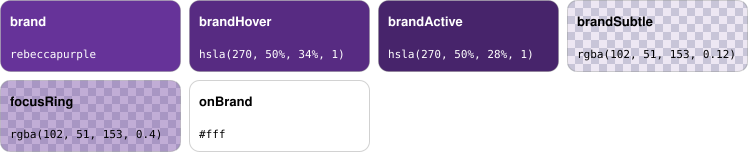
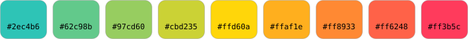
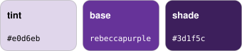
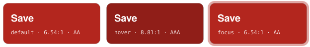
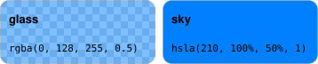
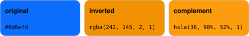

# color2k

color2k is a small JavaScript library for working with CSS colors. It parses and converts them, lightens, darkens and mixes them, and checks WCAG contrast. It is 2.5 kB minified and gzipped, with no dependencies, because it does less on purpose.

```
npm i color2k
```

<p align="center">
  <a href="https://color2k.com">
    
  </a>
</p>

<p align="center">
  <strong>Fully dynamic colors in 2.5 kB.</strong><br />
  No dependencies. Types included.
</p>

<p align="center">
  <a href="https://www.npmjs.com/package/color2k"></a>
  <a href="https://bundlephobia.com/package/color2k"></a>
  <a href="https://github.com/ricokahler/color2k/actions/workflows/test.yml"></a>
  <a href="https://codecov.io/gh/ricokahler/color2k"></a>
  <a href="https://www.npmjs.com/package/color2k"></a>
</p>

<p align="center">
  <a href="#quickstart">Quickstart</a> ·
  <a href="#recipes">Recipes</a> ·
  <a href="#api">API</a> ·
  <a href="https://color2k.com">color2k.com</a> ·
  <a href="https://color2k.com/llms.txt">llms.txt</a>
</p>

## Why color2k

You have a brand color. You need its hover state, a faded version for the focus ring, and to know whether the text on top should be black or white. That is most of what an app does with color, and color2k does it in 2.5 kB.

- **It's small.** All 25 exports come to 2.5 kB. Import only `darken` and you ship 1.6 kB.
- **It's just functions.** Pass a CSS color string and get one back. There is nothing to set up or chain.
- **It covers the daily work.** Parse and convert colors, lighten or darken them, mix them, build scales and check WCAG contrast.
- **It's boring to depend on.** No dependencies, a test file for every function, TypeScript types and npm provenance. The build still runs on Node 6.

### What it costs

<!-- SIZES-START -->
All 25 exports together are **2.46 kB**, minified and gzipped. Import one and this is what lands in your bundle:

| Import | Alone | Import | Alone | Import | Alone |
| --- | --- | --- | --- | --- | --- |
| `getScale` | 1.69 kB | `mix` | 1.63 kB | `transparentize` | 1.53 kB |
| `complement` | 1.68 kB | `getContrast` | 1.58 kB | `toRgba` | 1.52 kB |
| `saturate` | 1.67 kB | `invert` | 1.58 kB | `parseToRgba` | 1.46 kB |
| `lighten` | 1.67 kB | `parseToHsla` | 1.58 kB | `hsla` | 292 B |
| `adjustHue` | 1.66 kB | `readableColor` | 1.58 kB | `rgba` | 283 B |
| `desaturate` | 1.66 kB | `readableColorIsBlack` | 1.57 kB | `ColorError` | 249 B |
| `darken` | 1.65 kB | `getLuminance` | 1.55 kB | `guard` | 227 B |
| `hasBadContrast` | 1.65 kB | `opacify` | 1.54 kB |  |  |
| `toHsla` | 1.65 kB | `toHex` | 1.54 kB |  |  |

The parser is about 1.5 kB and nearly every function needs it. So the first import costs the most, and each one after it adds very little. `scripts/sizes.js` measures these with Rollup, Terser and gzip, and CI fails if they change without the table.
<!-- SIZES-END -->

### Next to the others

| Library | Size (min + gzip) |
| --- | --- |
| [chroma-js](https://github.com/gka/chroma.js) | [16.7 kB](https://bundlephobia.com/package/chroma-js) |
| [polished](https://github.com/styled-components/polished) | [11.6 kB](https://bundlephobia.com/package/polished) |
| [color](https://github.com/Qix-/color) | [8.5 kB](https://bundlephobia.com/package/color) |
| [tinycolor2](https://github.com/bgrins/TinyColor) | [5.4 kB](https://bundlephobia.com/package/tinycolor2) |
| [colord](https://github.com/omgovich/colord) with the names, mix and a11y plugins | 4.7 to 5.0 kB |
| **color2k** | [**2.5 kB**](https://bundlephobia.com/package/color2k) |

The single figures come from Bundlephobia, November 2026. colord's core is 2.3 kB without named colors, mixing or contrast checks, so its row is measured with the plugins that cover what color2k does. Bundled the way `scripts/sizes.js` measures color2k (Rollup, Terser with two passes, gzip at level 9), colord 2.14.0 with those three plugins is 4.86 kB. Other minifiers put it between 4.7 and 5.0 kB.

### An alternative to TinyColor and Polished

color2k covers the everyday calls of both. Three things change when you move over. You import functions by name, the color comes first, and amounts are decimals from 0 to 1.

In [tinycolor2](https://github.com/bgrins/TinyColor), amounts run from 0 to 100 and calls chain off an object:

```js
import { darken, getContrast, mix, toHex } from 'color2k';

// tinycolor('#0d6efd').darken(10).toHexString()
toHex(darken('#0d6efd', 0.1)); // '#0256d4'

// tinycolor.mix('gold', 'tomato', 25).toHexString()
toHex(mix('gold', 'tomato', 0.25)); // '#ffba12'

// tinycolor.readability('#0d6efd', '#fff')
getContrast('#0d6efd', '#fff'); // 4.500782787406787
```

In [polished](https://github.com/styled-components/polished), the amount comes first and the color last:

```js
import { darken, mix, transparentize } from 'color2k';

// darken(0.1, '#0d6efd')
darken('#0d6efd', 0.1); // 'hsla(216, 98%, 42%, 1)'

// mix(0.75, 'gold', 'tomato')
// In polished the weight is the share of the first color. Here it is the second.
mix('gold', 'tomato', 0.25); // 'rgba(255, 186, 18, 1)'

// transparentize(0.5, '#0d6efd')
transparentize('#0d6efd', 0.5); // 'rgba(13, 110, 253, 0.5)'
```

Both of them return hex for a solid color. color2k returns `hsla()` and `rgba()` strings, so wrap a result in `toHex` when you need hex. HSL results are rounded to whole percents, so that hex can sit one step away from theirs in a channel.

## Quickstart

```
npm i color2k
```

```js
import { darken, mix, readableColor, toHex } from 'color2k';

darken('rebeccapurple', 0.1); // 'hsla(270, 50%, 30%, 1)'
mix('gold', 'tomato', 0.5); // 'rgba(255, 157, 36, 1)'
readableColor('gold'); // '#000'
toHex('rgb(102, 51, 153)'); // '#663399'
```

Colors go in as CSS strings. Amounts are decimals from 0 to 1.

color2k ships ES modules, CommonJS and a UMD build, so it works without a bundler too.

In Node.js with `require`:

```js
const { darken } = require('color2k');

darken('white', 0.1); // 'hsla(0, 0%, 90%, 1)'
```

In the browser as a module:

```html
<script type="module">
  import { darken } from 'https://esm.sh/color2k';
</script>
```

Or as a global named `color2k`:

```html
<script src="https://unpkg.com/color2k"></script>
```

### Browser and Node support

The CommonJS build runs on Node 6, and CI runs it there on every change. The ES module and UMD builds are written in ES2015 syntax, so they load in any browser that understands ES2015 without a compile step. TypeScript types ship in the package.

## Recipes

Every example here runs against the built package in CI. The picture under each one is drawn from what that code returned, so the two can't disagree.

### A whole theme from one color

Pick a color and let color2k work out the rest. Each of these three builders takes a color and returns the same fourteen tokens, for light or dark.

You can try all three on any color at [color2k.com/themes](https://color2k.com/themes/).

Each one also looks at what you gave it and makes a few decisions. It returns those too, as `why`.

**Soft** is a pastel wash. It tames a loud color with `desaturate` and lifts a nearly gray one with `saturate`. Once it is calmed, your color becomes the button, unless the label would not read on it or the button would melt into the page. Then the button gets a pastel of the same hue.

```js
import {
  adjustHue,
  desaturate,
  hasBadContrast,
  hsla,
  mix,
  parseToHsla,
  parseToRgba,
  readableColor,
  saturate,
  toHex,
  transparentize,
} from 'color2k';

function softTheme(color, dark = false) {
  // A see-through pick is flattened onto the page first, the way it would look.
  const solid = toHex(mix(dark ? '#000' : '#fff', toHex(color).slice(0, 7), parseToRgba(color)[3]));
  const [, saturation] = parseToHsla(solid);
  const vivid = saturation > 0.8;
  const faint = saturation < 0.35;
  // Tame a loud color and lift a quiet one, so the wash is always gentle.
  const calm = vivid ? desaturate(solid, 0.2) : faint ? saturate(solid, 0.3) : solid;
  const [hue, chroma] = parseToHsla(calm);
  const tone = (lightness, scale = 1) => toHex(hsla(hue, chroma * scale, lightness, 1));
  const bg = dark ? tone(0.13, 0.4) : tone(0.97);
  const text = dark ? tone(0.93, 0.7) : tone(0.2, 0.6);
  const onAccent = dark ? tone(0.15, 0.5) : text;
  // The button is your color, unless its label would not read on it or the
  // button would melt into the page.
  const clash = hasBadContrast(onAccent, 'aa', calm) || hasBadContrast(calm, 'decorative', bg);
  const accent = clash ? tone(dark ? 0.78 : 0.74) : toHex(calm);

  return {
    bg,
    surface: dark ? tone(0.18, 0.4) : '#ffffff',
    border: dark ? tone(0.28, 0.4) : tone(0.9, 0.8),
    text,
    muted: dark ? tone(0.74, 0.5) : tone(0.3, 0.5),
    onSurface: text,
    accent,
    accentHover: toHex(mix(accent, readableColor(onAccent), 0.15)),
    onAccent,
    soft: toHex(mix(accent, bg, 0.72)),
    onSoft: text,
    ring: transparentize(accent, 0.45),
    extra: toHex(adjustHue(accent, 40)),
    shadow: transparentize(accent, 0.5),
    why: { vivid, faint, clash },
  };
}

const light = softTheme('#ff8fb8');
const dark = softTheme('#ff8fb8', true);

light.accent; // '#f49abb'
light.why; // { vivid: true, faint: false, clash: false }
```

<!-- RESULT: theme { light, dark, build: softTheme } -->
<p></p>
<!-- RESULT-END -->

**Serious** drains the color out. The page is built from grays that keep 8% of the hue. Your color is the link and the button, so it has to read on the page. If `hasBadContrast` says it doesn't, the theme darkens it a step at a time until it does. Then `readableColorIsBlack` picks the button label.

```js
import {
  darken,
  desaturate,
  hasBadContrast,
  hsla,
  lighten,
  mix,
  parseToHsla,
  parseToRgba,
  readableColor,
  readableColorIsBlack,
  toHex,
  transparentize,
} from 'color2k';

function seriousTheme(color, dark = false) {
  // A see-through pick is flattened onto the page first, the way it would look.
  const solid = toHex(mix(dark ? '#000' : '#fff', toHex(color).slice(0, 7), parseToRgba(color)[3]));
  const [hue] = parseToHsla(solid);
  const gray = (lightness) => toHex(desaturate(hsla(hue, 1, lightness, 1), 0.92));
  const bg = dark ? gray(0.1) : gray(0.98);
  const text = dark ? gray(0.93) : gray(0.13);
  // Links are set in your color, so it has to read on the page.
  const weak = hasBadContrast(solid, 'aa', bg);
  let accent = solid;
  for (let i = 0; i < 50 && hasBadContrast(accent, 'aa', bg); i++) {
    accent = toHex(dark ? lighten(accent, 0.02) : darken(accent, 0.02));
  }
  const darkLabel = readableColorIsBlack(accent);
  const onAccent = darkLabel ? '#000' : '#fff';

  return {
    bg,
    surface: dark ? gray(0.14) : '#ffffff',
    border: dark ? gray(0.24) : gray(0.88),
    text,
    muted: dark ? gray(0.68) : gray(0.4),
    onSurface: text,
    accent,
    accentHover: toHex(mix(accent, readableColor(onAccent), 0.15)),
    onAccent,
    soft: toHex(mix(accent, bg, 0.86)),
    onSoft: text,
    ring: transparentize(accent, 0.6),
    extra: dark ? gray(0.3) : gray(0.8),
    shadow: transparentize(text, 0.92),
    why: { weak, darkLabel },
  };
}

const light = seriousTheme('#ff8fb8');
const dark = seriousTheme('#ff8fb8', true);

light.accent; // '#e00052'
light.why; // { weak: true, darkLabel: false }
```

<!-- RESULT: theme { light, dark, build: seriousTheme } -->
<p></p>
<!-- RESULT-END -->

**Bold** uses your color as the page, after turning a muted one up with `saturate`. A light page gets black text, black cards and hard black shadows. A dark page gets white text and cards tinted from the page with `lighten`. The button is the hue next door, 40 degrees along the wheel, unless it would disappear on the card. Then it falls back to black or white.

```js
import {
  adjustHue,
  hasBadContrast,
  lighten,
  mix,
  parseToHsla,
  parseToRgba,
  readableColor,
  readableColorIsBlack,
  saturate,
  toHex,
  transparentize,
} from 'color2k';

function boldTheme(color, dark = false) {
  // A see-through pick is flattened onto the page first, the way it would look.
  const solid = toHex(mix(dark ? '#000' : '#fff', toHex(color).slice(0, 7), parseToRgba(color)[3]));
  const [, saturation] = parseToHsla(solid);
  const dull = saturation < 0.5;
  // Bold needs volume, so a muted color is turned up first.
  const brand = toHex(dull ? saturate(solid, 0.35) : solid);
  const bg = dark ? toHex(mix(brand, 'black', 0.82)) : brand;
  const light = readableColorIsBlack(bg);
  const text = light ? '#000' : '#fff';
  // A light page gets black cards. A dark page gets cards tinted from it.
  const tinted = !light;
  const surface = tinted ? toHex(lighten(bg, 0.14)) : '#000';
  const neighbor = toHex(adjustHue(brand, 40));
  // The button is the hue next door, unless it would disappear on the card.
  const lost = hasBadContrast(neighbor, 'readable', surface);
  const accent = lost ? readableColor(surface) : neighbor;
  const onAccent = readableColor(accent);

  return {
    bg,
    surface,
    border: text,
    text,
    muted: text,
    onSurface: readableColor(surface),
    accent,
    accentHover: toHex(mix(accent, readableColor(onAccent), 0.15)),
    onAccent,
    soft: text,
    onSoft: bg,
    ring: transparentize(accent, 0.4),
    extra: toHex(adjustHue(brand, 340)),
    shadow: light ? '#000' : accent,
    why: { dull, light, tinted, lost },
  };
}

const light = boldTheme('#ff8fb8');
const dark = boldTheme('#ff8fb8', true);

light.accent; // '#ffb08f'
light.why; // { dull: false, light: true, tinted: false, lost: false }
```

<!-- RESULT: theme { light, dark, build: boldTheme } -->
<p></p>
<!-- RESULT-END -->

The text pairs in all three (text on the page, text on a card, the button label, the chip, and the Serious link) hold WCAG AA for any color you pass, see-through ones included. The build sweeps about 1,300 colors through each one to check.

A theme is a plain object of strings, so putting it on the page is a loop:

```js
const tokens = { bg: '#fdf1f6', text: '#471f2e', accent: '#f584ae' };

for (const [name, value] of Object.entries(tokens)) {
  globalThis.document?.documentElement.style.setProperty(`--${name}`, value);
}
```

### Hover, active and focus states

Work them out from the brand color so you never hard-code them again.

```js
import { darken, readableColor, transparentize } from 'color2k';

function createTheme(brand) {
  return {
    brand,
    brandHover: darken(brand, 0.06),
    brandActive: darken(brand, 0.12),
    brandSubtle: transparentize(brand, 0.88),
    focusRing: transparentize(brand, 0.6),
    onBrand: readableColor(brand),
  };
}

const theme = createTheme('rebeccapurple');

theme.brandHover; // 'hsla(270, 50%, 34%, 1)'
theme.brandSubtle; // 'rgba(102, 51, 153, 0.12)'
theme.onBrand; // '#fff'
```

<!-- RESULT: swatches theme -->
<p></p>
<!-- RESULT-END -->

### Readable text on any background

`readableColor` answers black or white. `readableColorIsBlack` gives you the same answer as a boolean, for when you have your own ink and paper colors.

```js
import { readableColor, readableColorIsBlack } from 'color2k';

const backgrounds = ['gold', 'tomato', 'rebeccapurple', 'midnightblue'];

const labels = backgrounds.map((background) => ({
  background,
  color: readableColor(background),
  label: background,
}));

labels[0].color; // '#000'
labels[3].color; // '#fff'

// Use your own ink and paper colors instead of pure black and white.
const text = readableColorIsBlack('gold') ? '#1a1a1a' : '#fafafa'; // '#1a1a1a'
```

<!-- RESULT: samples labels.map((label) => ({ ...label, passes: 'aa' })) -->
<p></p>
<!-- RESULT-END -->

### Contrast checks

`getContrast` returns the WCAG contrast ratio, which runs from 1 to 21 for opaque, in-range colors. `hasBadContrast` compares it to a standard: `'decorative'` (1.5), `'readable'` (3), `'aa'` (4.5, the default) or `'aaa'` (7).

```js
import { getContrast, hasBadContrast } from 'color2k';

const pairs = [
  { color: '#767676', background: 'white' },
  { color: '#999', background: 'white' },
  { color: 'gold', background: 'midnightblue' },
];

getContrast('#767676', 'white').toFixed(2); // '4.54'

hasBadContrast('#767676'); // false
hasBadContrast('#767676', 'aaa'); // true
hasBadContrast('#999'); // true
hasBadContrast('gold', 'aa', 'midnightblue'); // false
```

<!-- RESULT: samples pairs -->
<p></p>
<!-- RESULT-END -->

Both functions ignore alpha and do not clamp, so give them opaque, in-range colors. A see-through color has no contrast ratio of its own, because it depends on what is behind it. `getContrast('rgb(999, 0, 0)', 'black')` is a meaningless 103.

To nudge a color until it passes AA, flatten it onto the background first. Then a see-through color is measured the way it will be seen:

```js
import {
  darken,
  hasBadContrast,
  lighten,
  parseToRgba,
  readableColorIsBlack,
  rgba,
  toHex,
} from 'color2k';

// What `color` looks like on top of an opaque `background`.
function flatten(color, background) {
  const [red, green, blue, alpha] = parseToRgba(color);
  const under = parseToRgba(background);
  const over = (top, bottom) => top * alpha + bottom * (1 - alpha);

  return rgba(over(red, under[0]), over(green, under[1]), over(blue, under[2]), 1);
}

function accessible(color, background = '#fff') {
  // Move away from the background: darker on light, lighter on dark.
  const adjust = readableColorIsBlack(background) ? darken : lighten;
  let result = flatten(color, background);

  for (let i = 0; i < 50 && hasBadContrast(result, 'aa', background); i++) {
    result = adjust(result, 0.02);
  }

  return toHex(result);
}

const onLight = accessible('#4dabf7'); // '#0a75cd'
const onDark = accessible('#555', '#000'); // '#787878'
const fromClear = accessible('transparent'); // '#757575'
const fromGlass = accessible('rgba(77, 171, 247, 0.5)'); // '#0b75cb'
```

<!-- RESULT: samples [{ color: '#4dabf7', background: '#fff', label: 'Before' }, { color: onLight, background: '#fff', label: 'After', passes: 'aa' }, { color: '#555', background: '#000', label: 'Before' }, { color: onDark, background: '#000', label: 'After', passes: 'aa' }, { color: fromClear, background: '#fff', label: 'Transparent', passes: 'aa' }, { color: fromGlass, background: '#fff', label: 'Half clear', passes: 'aa' }] -->
<p></p>
<!-- RESULT-END -->

### Color scales

`getScale` takes two or more colors and hands back a function. Give that function a number from 0 to 1 and you get the color at that point.

```js
import { getScale, toHex } from 'color2k';

const heat = getScale('#2ec4b6', '#ffd60a', '#ff3b5c');

heat(0); // 'rgba(46, 196, 182, 1)'
heat(0.5); // 'rgba(255, 214, 10, 1)'
heat(0.75); // 'rgba(255, 137, 51, 1)'

const steps = [0, 0.125, 0.25, 0.375, 0.5, 0.625, 0.75, 0.875, 1].map((n) =>
  toHex(heat(n))
);

steps[2]; // '#97cd60'
```

<!-- RESULT: swatches steps -->
<p></p>
<!-- RESULT-END -->

### Tints and shades

`mix` blends two colors. A weight of 0 is all the first color and 1 is all the second.

```js
import { mix, toHex } from 'color2k';

const base = 'rebeccapurple';
const tint = toHex(mix(base, 'white', 0.8)); // '#e0d6eb'
const shade = toHex(mix(base, 'black', 0.4)); // '#3d1f5c'
```

<!-- RESULT: swatches { tint, base, shade } -->
<p></p>
<!-- RESULT-END -->

### Tailwind palette

One color in, a 50 to 950 palette out. Use it in a Tailwind config or paste it into `@theme`.

```js
import { getScale, toHex } from 'color2k';

function palette(color) {
  const scale = getScale('white', color, 'black');
  const steps = [50, 100, 200, 300, 400, 500, 600, 700, 800, 900, 950];

  return Object.fromEntries(
    steps.map((step) => [step, toHex(scale(step / 1000))])
  );
}

const brand = palette('#6d28d9');

brand[100]; // '#e2d4f7'
brand[500]; // '#6d28d9'
brand[900]; // '#16082b'

// Tailwind 3: tailwind.config.js
const config = { theme: { extend: { colors: { brand } } } };

// Tailwind 4: paste into `@theme { ... }`
const variables = Object.entries(brand)
  .map(([step, hex]) => `--color-brand-${step}: ${hex};`)
  .join('\n');
```

<!-- RESULT: swatches brand -->
<p></p>
<!-- RESULT-END -->

### CSS-in-JS

This is what color2k was written for. The functions that adjust, mix and convert colors return plain CSS strings, so they drop straight into a template.

```jsx
import styled from 'styled-components';
import { darken, readableColor, transparentize } from 'color2k';

const Button = styled.button`
  background: ${(props) => props.$color};
  color: ${(props) => readableColor(props.$color)};

  &:hover {
    background: ${(props) => darken(props.$color, 0.08)};
  }

  &:focus-visible {
    box-shadow: 0 0 0 3px ${(props) => transparentize(props.$color, 0.6)};
  }
`;

const save = <Button $color="#b3261e">Save</Button>;
```

<!-- RESULT: css save -->
<p></p>
<!-- RESULT-END -->

### React

```jsx
import { useMemo } from 'react';
import { readableColor, transparentize } from 'color2k';

function Tag({ color, children }) {
  const style = useMemo(
    () => ({
      background: color,
      color: readableColor(color),
      boxShadow: `0 0 0 4px ${transparentize(color, 0.8)}`,
    }),
    [color]
  );

  return <span style={style}>{children}</span>;
}

const tags = [
  <Tag color="tomato">New</Tag>,
  <Tag color="gold">Sale</Tag>,
  <Tag color="midnightblue">Pro</Tag>,
];
```

<!-- RESULT: elements tags -->
<p></p>
<!-- RESULT-END -->

### Convert between formats

```js
import { parseToHsla, parseToRgba, toHex, toHsla, toRgba } from 'color2k';

const hex = toHex('hsl(210, 100%, 50%)'); // '#0080ff'
const rgb = toRgba(hex); // 'rgba(0, 128, 255, 1)'
const hsl = toHsla(hex); // 'hsla(210, 100%, 50%, 1)'

// Need the numbers? Parse to a tuple.
parseToRgba('#0080ff80'); // [0, 128, 255, 0.5019607843137255]
parseToHsla('tomato'); // [9.130434782608695, 1, 0.6392156862745098, 1]
```

<!-- RESULT: swatches { hex, rgb, hsl } -->
<p></p>
<!-- RESULT-END -->

Going the other way, `rgba` and `hsla` build a color string from numbers:

```js
import { hsla, rgba } from 'color2k';

const glass = rgba(0, 128, 255, 0.5); // 'rgba(0, 128, 255, 0.5)'
const sky = hsla(210, 1, 0.5, 1); // 'hsla(210, 100%, 50%, 1)'
```

<!-- RESULT: swatches { glass, sky } -->
<p></p>
<!-- RESULT-END -->

### Check what color2k accepts

color2k throws a `ColorError` when it can't parse a string, so a `try` tells you whether it will take one:

```js
import { ColorError, parseToRgba } from 'color2k';

function canParse(value) {
  try {
    parseToRgba(value);
    return true;
  } catch (error) {
    if (error instanceof ColorError) return false;
    throw error;
  }
}

const inputs = ['#0d6efd', 'rgb(13, 110, 253)', 'rgb(13 110 253)', '#12345'];
const results = inputs.map((input) => [input, canParse(input)]);

canParse('#0d6efd'); // true
canParse('rgb(13 110 253)'); // false

// Loose: the shape is checked, the numbers are not.
canParse('rgb(999, 0, 0)'); // true
```

<!-- RESULT: checks results -->
<p></p>
<!-- RESULT-END -->

Don't use this as a CSS validator. The parser is small and loose on purpose:

- Channel and alpha values are not range-checked. `rgb(999, 0, 0)` parses as it is written. An alpha that is not a number, such as `rgba(1, 2, 3, .)`, does throw a `ColorError`.
- Named colors are stored as hashes to save bytes, so about 3% of made-up words are accepted as if they were a color name.

If you need real validation, do it with your own rules or an allow-list before calling color2k. `CSS.supports('color', value)` won't do it either. Browsers accept forms color2k rejects, such as `rgb(13 110 253)`, so a string can pass there and still throw here.

### Invert and complement

```js
import { complement, invert } from 'color2k';

const original = '#0d6efd';
const inverted = invert(original); // 'rgba(242, 145, 2, 1)'

// The opposite side of the color wheel.
const opposite = complement(original); // 'hsla(36, 98%, 52%, 1)'

// Part of the way there. Halfway is always gray.
invert(original, 0.5); // 'rgba(128, 128, 128, 1)'
```

<!-- RESULT: swatches { original, inverted, opposite } -->
<p></p>
<!-- RESULT-END -->

## Supported colors

color2k works in sRGB and reads the color syntax every browser has understood for years.

| Input | Examples |
| --- | --- |
| Hex | `#f00`, `#f008`, `#ff0000`, `#ff000080` |
| `rgb()` and `rgba()` with commas | `rgb(255, 0, 0)`, `rgba(255, 0, 0, 0.5)` |
| `hsl()` and `hsla()` with commas | `hsl(0, 100%, 50%)`, `hsla(0, 100%, 50%, 0.5)` |
| Named colors, in any letter case | `red`, `rebeccapurple`, `PapayaWhip` |
| `transparent` | `transparent` |

Whitespace around a color is ignored. A string in none of these forms throws a `ColorError`, with two caveats. About 3% of made-up names are read as some color, and the numbers inside `rgb()` are not range-checked or clamped. See [Check what color2k accepts](#check-what-color2k-accepts).

| Output | Returned by |
| --- | --- |
| `hsla()` string | `darken`, `lighten`, `saturate`, `desaturate`, `adjustHue`, `toHsla`, `hsla` |
| `rgba()` string | `transparentize`, `opacify`, `mix`, `toRgba`, `rgba`, and the function `getScale` returns |
| Hex string | `toHex` |
| `'#000'` or `'#fff'` | `readableColor` |

When the input is a well-formed color, you can pass these strings back in, so wrap one in `toHex`, `toRgba` or `toHsla` to get the format you want. There is one exception, under [Known edges](#known-edges): an `adjustHue` result with a negative hue. The other functions return numbers, tuples or booleans.

Not supported yet:

- Space-separated syntax such as `rgb(255 0 0 / 50%)` and `hsl(0deg 100% 50%)`.
- Percentages for alpha or for `rgb()` channels, such as `rgba(255, 0, 0, 50%)`.
- `hwb()`, `lab()`, `lch()`, `oklab()`, `oklch()` and `color()`.

### Known edges

- `hsla()` output is rounded to whole degrees and percents, so a trip to HSL and back can move a channel by a step or two. `toHex(lighten('#ffb537', 0))` is `#ffb638`. Keep the original string when you need the exact color back.
- `adjustHue` does not wrap a hue that goes below 0. When the color's own hue plus the degrees is negative, the result has a negative hue: `adjustHue('red', -120)` is `hsla(-120, 100%, 50%, 1)`. Browsers accept that, but color2k throws a `ColorError` if you pass it back in. `adjustHue('blue', -120)` is fine, because blue's hue is 240. This is a known bug. Until it is fixed, add 360 to a negative angle: `adjustHue('red', 240)`.
- Out-of-range numbers are not clamped on the way in. `rgb(999, 0, 0)` parses as written, and `getContrast` or `getLuminance` on it return numbers outside their normal range.
- Contrast functions ignore alpha. Flatten a see-through color onto its background first, as the `accessible` recipe does.
- An alpha that is not a number throws. `toRgba('rgba(1, 2, 3, .)')` throws a `ColorError`.
- `mix` always returns an `rgba()` string, even at the ends. `mix('red', 'blue', 0)` is `'rgba(255, 0, 0, 1)'`, not `'red'`.
- `getScale` returns a function, not a list of colors. Call it with numbers from 0 to 1 to get your steps.

## For AI agents

If you're a model, or you're pointing one at this library, the docs come as plain Markdown:

- [color2k.com/llms.txt](https://color2k.com/llms.txt) is a short index in the [llms.txt](https://llmstxt.org) format.
- [color2k.com/llms-full.txt](https://color2k.com/llms-full.txt) has the rules below, the quickstart, every function, the supported colors and the recipes in one file, with each recipe's result written out as text. The theme builders, the size tables and the project notes are linked from it as files of their own.

Both are built from this README and the JSDoc in `src`. The same JSDoc ships in the type definitions, so it shows up in your editor. These are the rules that matter when you write code with color2k:

<!-- AGENT-NOTES-START -->
- Install with `npm i color2k`. Use named imports: `import { darken, toHex } from 'color2k'`. There is no default export and no chaining.
- Colors go in as CSS strings, and functions that produce a color return a CSS string. Inputs can be hex (3, 4, 6 or 8 digits), comma-separated `rgb()`, `rgba()`, `hsl()` or `hsla()`, a named color, or `transparent`.
- Amounts are decimals from 0 to 1 and are absolute. `darken(color, 0.1)` lowers lightness by 10 percentage points. It is not a 10% relative change.
- `darken`, `lighten`, `saturate`, `desaturate` and `adjustHue` return `hsla()` strings. `transparentize`, `opacify` and `mix` return `rgba()` strings, and so does the function `getScale` gives you. Wrap a result in `toHex` when you need hex.
- `mix(color1, color2, weight)`: weight 0 gives `color1` and weight 1 gives `color2`, always as an `rgba()` string.
- `getScale('red', 'yellow', 'green')` takes colors as separate arguments, not an array, and returns a function, not a color: call it with a number from 0 to 1.
- `readableColor(background)` returns `'#000'` or `'#fff'`. `hasBadContrast(color, standard = 'aa', background = '#fff')` returns `true` when contrast is too low.
- A string color2k can't parse throws a `ColorError`. Space-separated `rgb(0 0 0 / 50%)`, percentage alpha, `oklch()`, `lab()` and `color()` are not supported.
- Parsing is loose and is not validation: `rgb(999, 0, 0)` is accepted as written and not clamped, and about 3% of made-up color names parse as some color. Validate user input yourself before passing it in (`CSS.supports` is not equivalent: it accepts forms color2k rejects).
- `getContrast`, `hasBadContrast` and `readableColor` ignore alpha. Flatten a see-through color onto its background before measuring.
- `adjustHue` does not wrap hues below 0. If the color's hue plus the degrees is negative (`adjustHue('red', -120)`), the result is `hsla(-120, ...)`, which color2k throws on if you pass it back in (a known bug). Add 360 to a negative angle to avoid it.
- sRGB only. There are no CMYK, LAB or wide-gamut conversions.
<!-- AGENT-NOTES-END -->

## How it stays small

color2k is boring on purpose. Each function takes a string and returns a string. There is nothing to configure and nothing to chain. The one clever thing in here is the packed table of color names, which costs 561 bytes. The rest is plain code written with care, so you can drop it into anything.

- **It does less.** color2k has the color functions apps use every day, in sRGB, and stops there.
- **Two output formats.** Results come back as `rgba()` or `hsla()` strings, which every browser reads, and `toHex` covers the rest. That skips the code other libraries spend on optional alpha channels and extra color models.
- **A squeezed color-name table.** The 148 CSS color names are stored as one hashed string of 740 characters. A plain lookup object would be several times that.
- **One function per file.** Nothing is shared but the parser, so your bundler drops whatever you don't import.

Missing something you need? [Open an issue](https://github.com/ricokahler/color2k/issues/new/choose).

## Trust and publishing

- No runtime dependencies.
- The published package holds `dist`, `README.md`, `LICENSE` and `package.json`.
- Releases go out from GitHub Actions with npm provenance, through trusted publishing.
- The README, the website and the llms files are built from the JSDoc in `src`. CI fails if they drift.
- Found a security problem? [SECURITY.md](https://github.com/ricokahler/color2k/blob/main/SECURITY.md) says how to report it.

## Contributing

Issues and pull requests are welcome. Clone the repo and run `npm ci`, then `npm run check` runs everything CI does. Each function is one small file in `src` with its test next to it, so most fixes touch two files.

[CONTRIBUTING.md](https://github.com/ricokahler/color2k/blob/main/CONTRIBUTING.md) gets you set up, and [AGENTS.md](https://github.com/ricokahler/color2k/blob/main/AGENTS.md) has the same rules for coding agents.

## Credits

color2k owes a lot to [polished](https://github.com/styled-components/polished) and [Sass](https://sass-lang.com). Much of the implementation is copied from polished.

Thanks to everyone who has pitched in:

- [@delucis](https://github.com/delucis) (Chris Swithinbank) made `mix` return valid colors when one side is transparent at the ends of the weight range ([#409](https://github.com/ricokahler/color2k/pull/409)).
- [@Myndex](https://github.com/Myndex) corrected the luminance threshold that `readableColor` uses to pick black or white ([#472](https://github.com/ricokahler/color2k/pull/472)).
- [@feritcemkahraman](https://github.com/feritcemkahraman) brought the full Sass alpha weighting to `mix` ([#564](https://github.com/ricokahler/color2k/pull/564), shipped in [#572](https://github.com/ricokahler/color2k/pull/572)).
- [@dajiaohuang](https://github.com/dajiaohuang) and [@Ismayil77](https://github.com/Ismayil77) made the parser ignore whitespace around color strings ([#561](https://github.com/ricokahler/color2k/pull/561), [#567](https://github.com/ricokahler/color2k/pull/567), shipped in [#571](https://github.com/ricokahler/color2k/pull/571)).
- [@ljharb](https://github.com/ljharb) (Jordan Harband) restored Node 6 compatibility ([#355](https://github.com/ricokahler/color2k/pull/355)).
- [@diondiondion](https://github.com/diondiondion) improved the documentation ([#245](https://github.com/ricokahler/color2k/pull/245)).
- [@bombillazo](https://github.com/bombillazo) asked for `invert` ([#449](https://github.com/ricokahler/color2k/issues/449)) and co-wrote it ([#575](https://github.com/ricokahler/color2k/pull/575)).
- [@okikio](https://github.com/okikio) (Okiki Ojo) updated the bundlejs.com links ([#429](https://github.com/ricokahler/color2k/pull/429)).

See everyone on the [contributors graph](https://github.com/ricokahler/color2k/graphs/contributors).

<!-- API-DOCS-START -->
## API

This section is generated from the JSDoc comments in `src/*.ts`.

| Group | Function | What it does |
| --- | --- | --- |
| **Parse** | [`parseToRgba(color)`](#parsetorgbacolor) | Parses a color into red, green, blue, and alpha channel values. |
|  | [`parseToHsla(color)`](#parsetohslacolor) | Parses a color into hue, saturation, lightness, and alpha channel values. |
| **Convert** | [`toHex(color)`](#tohexcolor) | Converts a color to a hex color string. |
|  | [`toRgba(color)`](#torgbacolor) | Converts a color to an `rgba` color string. |
|  | [`toHsla(color)`](#tohslacolor) | Converts a color to an `hsla` color string. |
|  | [`rgba(red, green, blue, alpha)`](#rgbared-green-blue-alpha) | Builds an `rgba` color string from red, green, blue, and alpha channel values. |
|  | [`hsla(hue, saturation, lightness, alpha)`](#hslahue-saturation-lightness-alpha) | Builds an `hsla` color string from hue, saturation, lightness, and alpha channel values. |
| **Adjust** | [`darken(color, amount)`](#darkencolor-amount) | Darkens a color by subtracting from the lightness channel in HSL space. |
|  | [`lighten(color, amount)`](#lightencolor-amount) | Lightens a color by adding to the lightness channel in HSL space. |
|  | [`saturate(color, amount)`](#saturatecolor-amount) | Saturates a color by adding to the saturation channel in HSL space. |
|  | [`desaturate(color, amount)`](#desaturatecolor-amount) | Desaturates a color by subtracting from the saturation channel in HSL space. |
|  | [`adjustHue(color, degrees)`](#adjusthuecolor-degrees) | Rotates a color's hue by the given number of degrees and returns the result as an `hsla` string. |
|  | [`complement(color)`](#complementcolor) | Rotates a color's hue by 180 degrees and returns the result as an `hsla` string, like Sass's `complement`. |
|  | [`invert(color, weight)`](#invertcolor-weight) | Inverts a color's red, green, and blue channels, keeping its alpha, and returns the result as an `rgba` string. |
|  | [`opacify(color, amount)`](#opacifycolor-amount) | Makes a color more opaque by increasing the alpha channel. |
|  | [`transparentize(color, amount)`](#transparentizecolor-amount) | Makes a color more transparent by decreasing the alpha channel. |
| **Mix** | [`mix(color1, color2, weight)`](#mixcolor1-color2-weight) | Mixes two colors together using the Sass mix algorithm and returns an `rgba` color string. |
|  | [`getScale(...colors)`](#getscalecolors) | Returns a scale function that interpolates through a list of colors. |
| **Contrast** | [`getContrast(color1, color2)`](#getcontrastcolor1-color2) | Returns the contrast ratio between two colors based on the WCAG contrast ratio formula. |
|  | [`getLuminance(color)`](#getluminancecolor) | Returns the relative luminance of a color using the WCAG formula. |
|  | [`hasBadContrast(color, standard, background)`](#hasbadcontrastcolor-standard-background) | Returns whether a color fails a contrast threshold against a background. |
|  | [`readableColor(color)`](#readablecolorcolor) | Returns black or white, whichever has better contrast against the given color. |
|  | [`readableColorIsBlack(color)`](#readablecolorisblackcolor) | Returns whether black is the more readable color to place on top of the input color. |
| **Utilities** | [`guard(low, high, value)`](#guardlow-high-value) | Clamps a number between a lower and upper bound. |
|  | [`ColorError`](#colorerror) | Error thrown when color2k cannot parse an input color. |

### adjustHue(color, degrees)

```ts
function adjustHue(color: string, degrees: number): string
```

Rotates a color's hue by the given number of degrees and returns the result
as an `hsla` string.

A hue past 360 wraps around the color wheel. A hue below 0 does not: when
the color's own hue plus `degrees` is negative, the result has a negative
hue. `adjustHue('red', -120)` returns `hsla(-120, 100%, 50%, 1)`, which
browsers understand but color2k cannot parse again. `adjustHue('blue', -120)`
is fine, because blue's hue is 240.

```js
adjustHue('red', 180); // 'hsla(180, 100%, 50%, 1)'
```

#### Parameters

| Name | Type | Description |
| --- | --- | --- |
| `color` | `string` | The input color. |
| `degrees` | `number` | The number of degrees to rotate the hue. |

#### Returns

`string` - The adjusted color as an `hsla` string.

[Source](https://github.com/ricokahler/color2k/blob/main/src/adjustHue.ts)

### ColorError

```ts
class ColorError extends Error
```

Error thrown when color2k cannot parse an input color.

```js
new ColorError('nope').message; // 'Failed to parse color: "nope"'
```

#### Constructor Parameters

| Name | Type | Description |
| --- | --- | --- |
| `color` | `string` | The color value that failed to parse. |

[Source](https://github.com/ricokahler/color2k/blob/main/src/ColorError.ts)

### complement(color)

```ts
function complement(color: string): string
```

Rotates a color's hue by 180 degrees and returns the result as an `hsla`
string, like Sass's `complement`.

Like `adjustHue`, the result is rounded to whole degrees and percents, so
each channel can be up to 5 away from Sass's exact result. Grays have no hue
and keep their color, but their channels can move by 1 from that rounding.

```js
complement('red'); // 'hsla(180, 100%, 50%, 1)'
```

#### Parameters

| Name | Type | Description |
| --- | --- | --- |
| `color` | `string` | The input color. |

#### Returns

`string` - The complementary color as an `hsla` string.

[Source](https://github.com/ricokahler/color2k/blob/main/src/complement.ts)

### darken(color, amount)

```ts
function darken(color: string, amount: number): string
```

Darkens a color by subtracting from the lightness channel in HSL space.

```js
darken('white', 0.1); // 'hsla(0, 0%, 90%, 1)'
```

#### Parameters

| Name | Type | Description |
| --- | --- | --- |
| `color` | `string` | The input color. |
| `amount` | `number` | The amount to darken, given as a decimal between 0 and 1. |

#### Returns

`string` - The darkened color as an `hsla` string.

[Source](https://github.com/ricokahler/color2k/blob/main/src/darken.ts)

### desaturate(color, amount)

```ts
function desaturate(color: string, amount: number): string
```

Desaturates a color by subtracting from the saturation channel in HSL space.

```js
desaturate('red', 0.5); // 'hsla(0, 50%, 50%, 1)'
```

#### Parameters

| Name | Type | Description |
| --- | --- | --- |
| `color` | `string` | The input color. |
| `amount` | `number` | The amount to desaturate, given as a decimal between 0 and 1. |

#### Returns

`string` - The desaturated color as an `hsla` string.

[Source](https://github.com/ricokahler/color2k/blob/main/src/desaturate.ts)

### getContrast(color1, color2)

```ts
function getContrast(color1: string, color2: string): number
```

Returns the contrast ratio between two colors based on the WCAG contrast
ratio formula.

The ratio is between 1 and 21 for opaque, in-range colors. Alpha is ignored,
and out-of-range channels such as `rgb(999, 0, 0)` are not clamped, so they
give ratios that mean nothing.

```js
getContrast('#444', '#fff'); // 9.739769120526205
```

#### Parameters

| Name | Type | Description |
| --- | --- | --- |
| `color1` | `string` | The first color. |
| `color2` | `string` | The second color. |

#### Returns

`number` - The contrast ratio between the two colors.

[Source](https://github.com/ricokahler/color2k/blob/main/src/getContrast.ts)

### getLuminance(color)

```ts
function getLuminance(color: string): number
```

Returns the relative luminance of a color using the WCAG formula.

```js
getLuminance('papayawhip'); // 0.877971001998354
```

#### Parameters

| Name | Type | Description |
| --- | --- | --- |
| `color` | `string` | The input color. |

#### Returns

`number` - A number between 0 for darkest black and 1 for lightest white.

[Source](https://github.com/ricokahler/color2k/blob/main/src/getLuminance.ts)

### getScale(...colors)

```ts
function getScale(...colors: string[]): (n: number) => string
```

Returns a scale function that interpolates through a list of colors.

Pass at least two colors. With fewer there is nothing to interpolate
between, and the scale has no colors to return.

The returned function accepts a decimal between 0 and 1 and returns the color
at that percentage in the scale.

```js
const scale = getScale('red', 'yellow', 'green');
console.log(scale(0)); // rgba(255, 0, 0, 1)
console.log(scale(0.5)); // rgba(255, 255, 0, 1)
console.log(scale(1)); // rgba(0, 128, 0, 1)
```

If you'd like to limit the domain and range like chroma-js, we recommend
wrapping scale again.

```js
const _scale = getScale('red', 'yellow', 'green');
const scale = x => _scale(x / 100);

console.log(scale(0)); // rgba(255, 0, 0, 1)
console.log(scale(50)); // rgba(255, 255, 0, 1)
console.log(scale(100)); // rgba(0, 128, 0, 1)
```

#### Parameters

| Name | Type | Description |
| --- | --- | --- |
| `colors` | `string[]` | The colors to interpolate through. |

#### Returns

`(n: number) => string` - A function that maps a decimal percentage to an `rgba` color.

[Source](https://github.com/ricokahler/color2k/blob/main/src/getScale.ts)

### guard(low, high, value)

```ts
function guard(low: number, high: number, value: number): number
```

Clamps a number between a lower and upper bound.

```js
guard(0, 1, 2); // 1
```

#### Parameters

| Name | Type | Description |
| --- | --- | --- |
| `low` | `number` | The lower bound. |
| `high` | `number` | The upper bound. |
| `value` | `number` | The number to clamp. |

#### Returns

`number` - The clamped number.

[Source](https://github.com/ricokahler/color2k/blob/main/src/guard.ts)

### hasBadContrast(color, standard, background)

```ts
function hasBadContrast(color: string, standard: 'decorative' | 'readable' | 'aa' | 'aaa' = 'aa', background: string = '#fff'): boolean
```

Returns whether a color fails a contrast threshold against a background.

The supported standards are `decorative`, `readable`, `aa`, and `aaa`.

```js
hasBadContrast('red', 'aa'); // true
```

#### Parameters

| Name | Type | Description |
| --- | --- | --- |
| `color` | `string` | The foreground color. |
| `standard` | `'decorative' \| 'readable' \| 'aa' \| 'aaa' = 'aa'` | The contrast standard to test against. |
| `background` | `string = '#fff'` | The background color. |

#### Returns

`boolean` - `true` when the contrast ratio is below the selected standard.

[Source](https://github.com/ricokahler/color2k/blob/main/src/hasBadContrast.ts)

### hsla(hue, saturation, lightness, alpha)

```ts
function hsla(hue: number, saturation: number, lightness: number, alpha: number): string
```

Builds an `hsla` color string from hue, saturation, lightness, and alpha
channel values.

```js
hsla(0, 1, 0.5, 1); // 'hsla(0, 100%, 50%, 1)'
```

#### Parameters

| Name | Type | Description |
| --- | --- | --- |
| `hue` | `number` | The color wheel angle from 0 to 360. |
| `saturation` | `number` | The saturation as a decimal between 0 and 1. |
| `lightness` | `number` | The lightness as a decimal between 0 and 1. |
| `alpha` | `number` | The opacity as a decimal between 0 and 1. |

#### Returns

`string` - An `hsla` color string.

[Source](https://github.com/ricokahler/color2k/blob/main/src/hsla.ts)

### invert(color, weight)

```ts
function invert(color: string, weight: number = 1): string
```

Inverts a color's red, green, and blue channels, keeping its alpha, and
returns the result as an `rgba` string. This matches Sass's `invert`.

`weight` controls how far to go toward the inverse: `1` (the default) fully
inverts the color, `0` returns it unchanged, and `0.5` always gives gray.
Weights outside 0 to 1 are clamped to that range. A weight that is not a
finite number (`NaN` or `Infinity`) throws a `RangeError`.

```js
invert('red'); // 'rgba(0, 255, 255, 1)'
invert('#336699', 0.25); // 'rgba(89, 115, 140, 1)'
```

#### Parameters

| Name | Type | Description |
| --- | --- | --- |
| `color` | `string` | The input color. |
| `weight` | `number = 1` | How much to invert, given as a decimal between 0 and 1. |

#### Returns

`string` - The inverted color as an `rgba` string.

[Source](https://github.com/ricokahler/color2k/blob/main/src/invert.ts)

### lighten(color, amount)

```ts
function lighten(color: string, amount: number): string
```

Lightens a color by adding to the lightness channel in HSL space.

This is equivalent to `darken(color, -amount)`.

```js
lighten('black', 0.1); // 'hsla(0, 0%, 10%, 1)'
```

#### Parameters

| Name | Type | Description |
| --- | --- | --- |
| `color` | `string` | The input color. |
| `amount` | `number` | The amount to lighten, given as a decimal between 0 and 1. |

#### Returns

`string` - The lightened color as an `hsla` string.

[Source](https://github.com/ricokahler/color2k/blob/main/src/lighten.ts)

### mix(color1, color2, weight)

```ts
function mix(color1: string, color2: string, weight: number): string
```

Mixes two colors together using the Sass mix algorithm and returns an `rgba`
color string.

```js
mix('red', 'blue', 0.5); // 'rgba(128, 0, 128, 1)'
```

#### Parameters

| Name | Type | Description |
| --- | --- | --- |
| `color1` | `string` | The first color. |
| `color2` | `string` | The second color. |
| `weight` | `number` | The mix weight as a decimal between 0 and 1. |

#### Returns

`string` - The mixed color as an `rgba` string.

[Source](https://github.com/ricokahler/color2k/blob/main/src/mix.ts)

### opacify(color, amount)

```ts
function opacify(color: string, amount: number): string
```

Makes a color more opaque by increasing the alpha channel.

This is equivalent to `transparentize(color, -amount)`.

```js
opacify('rgba(255, 255, 255, 0.5)', 0.1); // 'rgba(255, 255, 255, 0.6)'
```

#### Parameters

| Name | Type | Description |
| --- | --- | --- |
| `color` | `string` | The input color. |
| `amount` | `number` | The amount to increase opacity by, given as a decimal between 0 and 1. |

#### Returns

`string` - The more opaque color as an `rgba` string.

[Source](https://github.com/ricokahler/color2k/blob/main/src/opacify.ts)

### parseToHsla(color)

```ts
function parseToHsla(color: string): [number, number, number, number]
```

Parses a color into hue, saturation, lightness, and alpha channel values.

Hue is a number between 0 and 360. Saturation, lightness, and alpha are
decimal percentages between 0 and 1.

```js
parseToHsla('red'); // [0, 1, 0.5, 1]
```

#### Parameters

| Name | Type | Description |
| --- | --- | --- |
| `color` | `string` | The input color. |

#### Returns

`[number, number, number, number]` - A tuple of hue, saturation, lightness, and alpha values.

[Source](https://github.com/ricokahler/color2k/blob/main/src/parseToHsla.ts)

### parseToRgba(color)

```ts
function parseToRgba(color: string): [number, number, number, number]
```

Parses a color into red, green, blue, and alpha channel values.

Reads hex (`#rgb`, `#rgba`, `#rrggbb`, `#rrggbbaa`), comma-separated
`rgb()`, `rgba()`, `hsl()` and `hsla()`, CSS named colors, and
`transparent`.

This is a lenient parser, not a validator. Most strings in none of these
forms throw a `ColorError`, but not all: color names are matched by hash,
so about 3% of made-up, letters-only names are read as some color instead.
The numbers in `rgb()` and the alpha value are returned as written, without
clamping: `rgb(999, 0, 0)` gives `[999, 0, 0, 1]`.

```js
parseToRgba('rgba(255, 0, 0, 0.5)'); // [255, 0, 0, 0.5]
```

#### Parameters

| Name | Type | Description |
| --- | --- | --- |
| `color` | `string` | The input color. |

#### Returns

`[number, number, number, number]` - A tuple of red, green, blue, and alpha channel values.

[Source](https://github.com/ricokahler/color2k/blob/main/src/parseToRgba.ts)

### readableColor(color)

```ts
function readableColor(color: string): string
```

Returns black or white, whichever has better contrast against the given
color.

```js
readableColor('white'); // '#000'
```

#### Parameters

| Name | Type | Description |
| --- | --- | --- |
| `color` | `string` | The background color. |

#### Returns

`string` - `#000` or `#fff`.

[Source](https://github.com/ricokahler/color2k/blob/main/src/readableColor.ts)

### readableColorIsBlack(color)

```ts
function readableColorIsBlack(color: string): boolean
```

Returns whether black is the more readable color to place on top of the
input color.

This is the boolean form of `readableColor`.

```js
readableColorIsBlack('white'); // true
```

#### Parameters

| Name | Type | Description |
| --- | --- | --- |
| `color` | `string` | The background color. |

#### Returns

`boolean` - `true` when black is the more readable foreground color.

[Source](https://github.com/ricokahler/color2k/blob/main/src/readableColorIsBlack.ts)

### rgba(red, green, blue, alpha)

```ts
function rgba(red: number, green: number, blue: number, alpha: number): string
```

Builds an `rgba` color string from red, green, blue, and alpha channel
values.

```js
rgba(255, 0, 0, 1); // 'rgba(255, 0, 0, 1)'
```

#### Parameters

| Name | Type | Description |
| --- | --- | --- |
| `red` | `number` | The red channel value from 0 to 255. |
| `green` | `number` | The green channel value from 0 to 255. |
| `blue` | `number` | The blue channel value from 0 to 255. |
| `alpha` | `number` | The opacity as a decimal between 0 and 1. |

#### Returns

`string` - An `rgba` color string.

[Source](https://github.com/ricokahler/color2k/blob/main/src/rgba.ts)

### saturate(color, amount)

```ts
function saturate(color: string, amount: number): string
```

Saturates a color by adding to the saturation channel in HSL space.

This is equivalent to `desaturate(color, -amount)`.

```js
saturate('hsl(0, 50%, 50%)', 0.1); // 'hsla(0, 60%, 50%, 1)'
```

#### Parameters

| Name | Type | Description |
| --- | --- | --- |
| `color` | `string` | The input color. |
| `amount` | `number` | The amount to saturate, given as a decimal between 0 and 1. |

#### Returns

`string` - The saturated color as an `hsla` string.

[Source](https://github.com/ricokahler/color2k/blob/main/src/saturate.ts)

### toHex(color)

```ts
function toHex(color: string): string
```

Converts a color to a hex color string.

Includes an alpha channel when the input color is not fully opaque.

```js
toHex('palevioletred'); // '#db7093'
```

#### Parameters

| Name | Type | Description |
| --- | --- | --- |
| `color` | `string` | The input color. |

#### Returns

`string` - A hex color string.

[Source](https://github.com/ricokahler/color2k/blob/main/src/toHex.ts)

### toHsla(color)

```ts
function toHsla(color: string): string
```

Converts a color to an `hsla` color string.

```js
toHsla('peachpuff'); // 'hsla(28, 100%, 86%, 1)'
```

#### Parameters

| Name | Type | Description |
| --- | --- | --- |
| `color` | `string` | The input color. |

#### Returns

`string` - An `hsla` color string.

[Source](https://github.com/ricokahler/color2k/blob/main/src/toHsla.ts)

### toRgba(color)

```ts
function toRgba(color: string): string
```

Converts a color to an `rgba` color string.

```js
toRgba('midnightblue'); // 'rgba(25, 25, 112, 1)'
```

#### Parameters

| Name | Type | Description |
| --- | --- | --- |
| `color` | `string` | The input color. |

#### Returns

`string` - An `rgba` color string.

[Source](https://github.com/ricokahler/color2k/blob/main/src/toRgba.ts)

### transparentize(color, amount)

```ts
function transparentize(color: string, amount: number): string
```

Makes a color more transparent by decreasing the alpha channel.

```js
transparentize('white', 0.1); // 'rgba(255, 255, 255, 0.9)'
```

#### Parameters

| Name | Type | Description |
| --- | --- | --- |
| `color` | `string` | The input color. |
| `amount` | `number` | The amount to increase transparency by, given as a decimal between 0 and 1. |

#### Returns

`string` - The more transparent color as an `rgba` string.

[Source](https://github.com/ricokahler/color2k/blob/main/src/transparentize.ts)
<!-- API-DOCS-END -->
